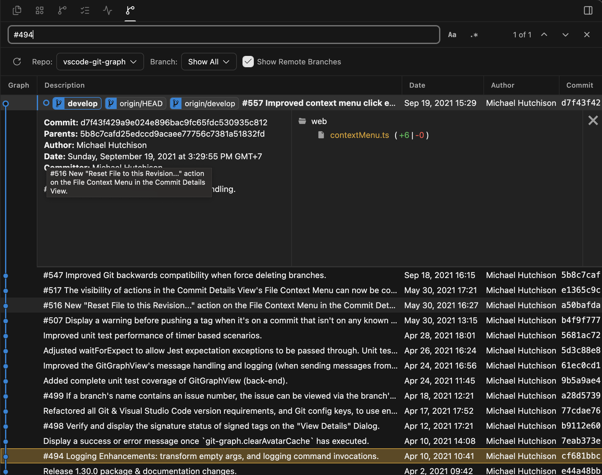

# Git Graph for Orca

A sidebar panel for [Orca](https://github.com/stablyai/orca) that shows your repository's commit graph
and runs common Git actions from it.

It runs entirely on your machine: it calls the `git` on your `PATH` in your own repositories.



## Features

- Commit graph with branches, tags and remotes, loaded in pages and virtualized, so histories of
  100,000+ commits stay responsive.
- Commit details: files changed, a tree view, and an in-panel diff (unified or side by side).
- Git actions from the context menus: checkout, create, rename and delete branches, merge, rebase,
  cherry-pick, revert, reset, tags, fetch, pull, push, copy hash and more.
- Search with Ctrl/Cmd+Shift+F: description, hash, author, branch, date; match case and regex.
- Up/Down arrows move through the commits.
- Follows Orca: the panel opens on the focused workspace's repository, switches when you switch
  projects, and follows Orca's light or dark theme live.
- Responsive: columns drop away as the sidebar narrows.
- Large repositories get a Git `commit-graph` cache file written once in the background, which makes
  loading far faster (a setting turns it off). See [docs/performance.md](docs/performance.md).

## Install

Not listed in Orca's plugin catalog yet. To run it from source:

```sh
git clone https://github.com/thanhtrung5763/orca-git-graph
cd orca-git-graph
pnpm install
pnpm run build
orca plugin validate .
orca plugin dev watch .     # asks you to approve the plugin, then loads it
```

Requires Orca 1.4.248 or later, Node.js 24 and pnpm. Open the **Git Graph** icon in Orca's right
sidebar. The plugin runs its own Node process with your account's access (it runs `git`, watches files
and reads your workspaces), which is why Orca asks you to approve it.

## Settings

In Orca's Settings, under the plugin: date format and type, graph colours and style, how many commits
load at first and per "load more", whether to show uncommitted changes, whether to start on the current
branch only, and "Speed up large repositories".

## Development

| Script               | What it does                                    |
| -------------------- | ----------------------------------------------- |
| `pnpm run build`     | Build the worker and the panel into `out-orca/` |
| `pnpm run watch`     | The same, rebuilding on change                  |
| `pnpm run typecheck` | Typecheck everything                            |
| `pnpm run lint`      | Lint (oxlint)                                   |
| `pnpm run format`    | Check formatting (oxfmt)                        |
| `pnpm run test`      | Run the tests                                   |
| `pnpm run bench`     | Measure on real repositories                    |

How it is built is in [docs/orca-plugin.md](docs/orca-plugin.md).

## Licence

[MIT](LICENSE). Based on [neo-git-graph](https://github.com/asispts/neo-git-graph).
